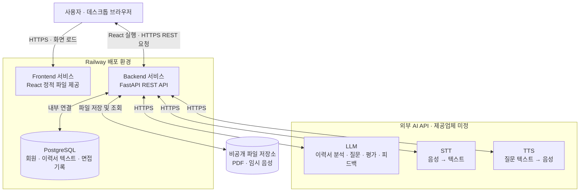
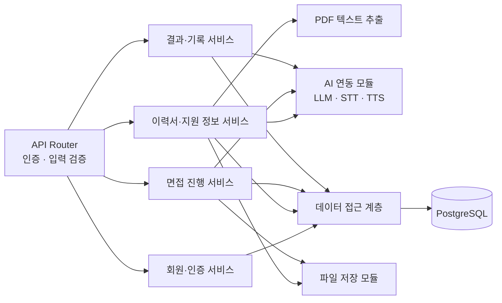
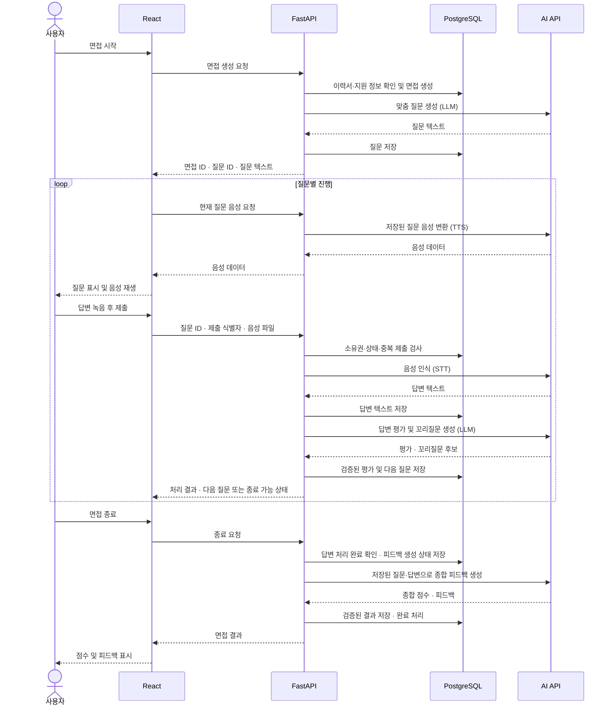

# 시스템 아키텍처

안심 AI는 이력서와 지원 직무를 바탕으로 질문을 생성하고, 음성 답변을 분석하여 꼬리질문과 면접 피드백을 제공하는 웹 서비스다.

이 문서는 2인 팀·약 3개월의 MVP를 위한 **구현 전 설계안**이다. React, FastAPI, PostgreSQL, Railway는 기획서의 기술 스택을 따른다. 파일 저장소, 상태 관리 등 세부 구성은 설계 제안이며, AI 제공업체와 API 주소·요청·응답 형식은 아직 미정이다.

## 1. 전체 구성도

React는 사용자 브라우저에서 실행된다. Frontend 서비스는 빌드된 화면 파일을 제공하고, 브라우저가 Backend API를 호출한다. 데이터베이스·파일 저장소·AI API 접근은 Backend에서 제어한다.

MVP는 **하나의 FastAPI 애플리케이션 안에서 기능별 모듈을 분리하는 구조**로 구성한다. 음성 면접은 질문 재생 후 답변 녹음을 제출하는 턴 단위 방식으로 설계한다. 실시간 양방향 음성 스트리밍은 향후 확장 범위다.

## 2. 구성 요소와 역할

| 구성 요소 | 주요 역할 |
| --- | --- |
| React Frontend | 로그인, PDF 업로드, 지원 정보 입력, 마이크 녹음, 질문 음성 재생, 결과·기록 표시 |
| FastAPI Backend | 인증·소유권 검사, 입력 검증, PDF 텍스트 추출, 면접 진행 제어, AI 호출 및 결과 저장 |
| PostgreSQL | 회원, 이력서 메타데이터·텍스트, 지원 정보, 면접, 질문, 답변, 평가 저장 |
| 비공개 파일 저장소 | 원본 PDF 및 처리용 임시 음성 보관 |
| LLM API | 이력서 분석, 맞춤 질문, 답변 평가, 꼬리질문, 종합 피드백 생성 |
| STT API | 사용자 녹음을 답변 텍스트로 변환 |
| TTS API | 질문 텍스트를 면접관 음성으로 변환 |

### Backend 내부 구조

AI 연동 모듈은 제공업체별 요청 변환, 시간 제한, 오류 처리, 응답 검증을 담당한다. 면접 진행 서비스는 현재 질문, 답변 제출 여부, 다음 질문과 종료 여부를 판단한다. AI가 반환한 내용에 Backend 규칙을 적용한 뒤 면접 상태를 변경한다.

## 3. 주요 처리 흐름

### 3.1 이력서 등록 및 질문 준비

1. 로그인한 사용자가 PDF 이력서를 업로드한다.
2. Backend가 인증, 파일 크기, 확장자와 실제 파일 형식을 검사한다.
3. PDF를 비공개 저장소에 저장하고 텍스트를 추출한다. 추출할 수 없는 스캔 PDF는 재등록을 안내하며, OCR은 별도 확장으로 둔다.
4. 추출한 텍스트를 LLM으로 분석하고, 검증한 결과와 처리 상태를 저장한다.
5. 사용자가 지원 기업·직무·모집공고 내용을 입력하면 PostgreSQL에 저장한다.
6. 면접 생성 시 이력서와 지원 정보의 소유권·준비 상태를 확인하고, 해당 시점의 내용을 면접용 스냅샷으로 보관한다.
7. LLM으로 맞춤 질문을 생성하고 검증·저장한 뒤 첫 질문을 제공한다.

모집공고는 MVP에서 사용자가 입력한 텍스트를 이용한다. 외부 사이트 자동 수집은 별도로 설계한다.

### 3.2 음성 면접 시퀀스

도식은 정상 처리 흐름이다. 질문 수와 꼬리질문 횟수는 서버 설정으로 제한한다. 마지막 답변을 처리하는 동안에는 종료 처리를 대기시키고, 완료된 면접에는 답변을 추가하지 않는다. 재면접은 새 면접 ID로 생성한다.

### 3.3 결과 및 기록 조회

Backend는 로그인 사용자 소유의 면접만 조회하여 저장된 질문·답변·점수·피드백을 반환한다. 기록을 열 때마다 AI를 다시 호출하지 않는다. 이전 결과 비교는 동일한 평가 기준의 결과를 기준으로 제공한다.

## 4. 데이터 및 파일 저장

| 저장 대상 | 저장 위치 | 처리 원칙 |
| --- | --- | --- |
| 회원 정보 | PostgreSQL | 비밀번호는 해시로 저장 |
| 이력서 PDF | 비공개 파일 저장소 | 공개 URL 대신 저장 키로 관리 |
| 이력서 텍스트·분석 결과 | PostgreSQL | 소유자 및 분석 상태 연결 |
| 지원 기업·직무·모집공고 | PostgreSQL | 사용자별 관리 |
| 면접·질문·답변·평가 | PostgreSQL | 면접 → 질문 → 답변 관계로 저장 |
| 면접 시작 시 입력 정보 | PostgreSQL | 이력서 수정 이후에도 당시 면접 문맥 보존 |
| 답변 녹음 | 임시 파일 저장소 | STT 처리·재시도에 사용 후 보존 기간에 따라 삭제 |
| 질문 음성 | 임시 저장 또는 응답 전송 | 실패해도 질문 텍스트로 진행 가능 |

파일 저장소는 비공개 객체 저장소를 사용하는 안을 제안하며 제품은 추후 선정한다. Backend 컨테이너의 임시 디스크를 원본 PDF의 영구 저장소로 사용하지 않는다. 파일 다운로드는 소유권 확인 후 Backend가 중계하거나 짧은 만료 시간을 가진 서명 URL로 제공한다.

[ERD 초안](./ERD.md)의 엔터티를 기준으로 구현 전 다음 항목을 추가 설계한다.

- 이력서 분석 상태, 면접 상태, 답변 처리 단계와 실패 사유
- 질문 순서, 꼬리질문의 원 질문 ID, 답변 제출 식별자와 중복 방지 제약
- 면접 시작 시 이력서·지원 정보 스냅샷
- 모델·프롬프트·평가 기준 버전 및 결과 생성 시각
- 비공개 파일 저장 키와 삭제 예정 시각: 기존 `file_url`, `audio_url`의 의미 조정 필요

## 5. 상태 관리 및 장애 대응

면접 상태는 `preparing → in_progress → feedback_pending → completed`로 관리하는 안을 제안한다. 준비 또는 피드백 생성 실패 시 실패 단계와 오류를 기록하고 해당 단계부터 다시 처리한다. 답변별 STT·평가 실패는 면접 전체 실패와 분리한다.

MVP에서는 요청 단위로 AI 처리를 수행한다. 외부 호출 전에 처리 상태를 저장하고 완료 후 결과를 저장하며, 외부 호출을 기다리는 동안 DB 트랜잭션을 유지하지 않는다. 서버 재시작 등으로 남은 처리 중 상태는 제한 시간 이후 재시도 가능한 상태로 복구한다.

| 상황 | 대응 |
| --- | --- |
| 마이크 권한 거부·녹음 실패 | 권한 설정 및 재녹음을 안내하고 현재 질문 유지 |
| PDF 추출·분석 실패 | 실패 상태를 표시하고 파일 재등록 또는 분석 재시도 제공 |
| STT 실패·빈 텍스트 | 분석 단계로 넘어가지 않고 재시도·재녹음 제공 |
| TTS 실패 | 질문 텍스트를 표시하고 음성 재생 재시도 제공 |
| LLM 시간 초과·호출 제한 | 시간 제한과 제한된 횟수의 지연 재시도 적용, 실패 단계 보존 |
| LLM 응답 형식 오류 | 질문·점수·피드백 스키마와 값 범위 검증 후 저장, 실패 시 재시도 가능 처리 |
| 답변 중복 제출·응답 유실 | 제출 식별자와 DB 제약으로 중복 저장 방지, 저장된 결과 재조회 |
| 동시 답변 제출 | 현재 질문과 처리 상태를 원자적으로 검사하여 하나의 제출만 진행 |
| 종합 피드백 생성 실패 | 기존 질문·답변을 보존하고 피드백 생성만 재시도 |

처리 상태 조회 기능으로 새로고침 후에도 진행 상태를 복구한다. 외부 API 호출 자체의 중복 비용은 제공업체 지원 여부에 따라 남을 수 있으므로 호출 식별자와 사용량을 기록한다. 처리 시간이 요청 제한을 자주 넘으면 영속 작업 큐와 Worker를 추가하고 작업 ID 반환·상태 조회 방식으로 확장한다.

## 6. 인증 및 데이터 보호

- JWT 기반 인증을 적용하고 사용자 ID는 검증된 인증 정보에서 가져온다. 모든 이력서·면접·파일 접근에 소유권 검사를 수행한다.
- JWT 만료, 갱신, 로그아웃 시 무효화 방식과 브라우저 보관 방식은 API 설계에서 함께 확정한다.
- AI API 키, DB 접속 정보, JWT 서명 키는 Backend 환경 변수로 관리한다. Frontend 빌드 파일에 비밀 값을 포함하지 않는다.
- 브라우저 통신에는 HTTPS를 사용하고 CORS 허용 출처를 배포된 Frontend 주소로 제한한다.
- PDF 크기·페이지 수, 음성 크기·길이, 요청 빈도, 사용자별 AI 사용량에 제한을 둔다. 수치는 시연 및 부하 확인 후 확정한다.
- AI에 전달할 때 불필요한 연락처 등 개인정보를 제외한다. 이력서·모집공고·답변 속 지시문은 분석 대상 데이터로 취급하며, AI 출력으로 도구 실행이나 권한 변경을 수행하지 않는다.
- 로그에는 비밀번호·토큰·원문 이력서·음성을 남기지 않는다. 데이터 보존·삭제 정책 및 외부 AI 전송 안내는 서비스 공개 전 확정한다.

## 7. 배포 및 운영

Railway에 Frontend, Backend, PostgreSQL을 각각 배치하는 구성을 목표로 한다. PostgreSQL은 Backend에서만 접근하도록 네트워크와 자격 증명을 구성한다. 실제 연결 방식과 배포 설정은 배포 시 확인한다.

| 항목 | 설계 기준 |
| --- | --- |
| 환경 분리 | 개발·운영의 DB, 파일 경로, AI 키 분리 |
| 배포 절차 | 변경 검증 → 빌드 → DB 마이그레이션 → 배포 → 상태 확인 |
| 상태 확인 | 서버 생존 여부와 DB 연결 준비 여부를 구분, AI 호출은 매번 수행하지 않음 |
| 로그·관측 | 요청 ID, 처리 단계, AI 지연 시간·오류율·사용량 기록 |
| 백업 | DB 백업 및 복구 절차 마련, PDF 보존 정책과 함께 복구 확인 |
| 배포 실패 대응 | 이전 애플리케이션 버전 복구, DB 변경은 이전 버전과의 호환성 확인 |

## 8. 확정이 필요한 항목

| 항목 | 후속 결정 |
| --- | --- |
| API 계약 | URL·메서드, 인증 전달 방식, 오류 형식, 파일 업로드·상태 조회·중복 제출 규칙 |
| AI 제공업체 | 모델, 지원 음성 형식, 시간 제한, 비용 및 데이터 보존 조건 |
| 파일 저장 | 저장소 제품, 용량 제한, PDF·임시 음성 보존 및 삭제 기간 |
| 면접 규칙 | 기본 질문 수, 꼬리질문 상한, 답변 시간, 중도 종료 및 재접속 처리 |
| 평가 기준 | 점수 범위·가중치, 종합 점수 계산 방식, 버전별 비교 기준 |
| 운영 설정 | 요청 시간 제한, 동시 사용자 목표, 백업 주기, 작업 큐 도입 기준 |

## 관련 문서

- [프로젝트 기획서](../프로젝트_기획서.md)
- [기능 명세서](../기능/기능_명세서.md)
- [사용자 흐름](./UserFlow.md)
- [API 명세서](./API_명세서.md)
- [ERD 및 데이터 구조](./ERD.md)
